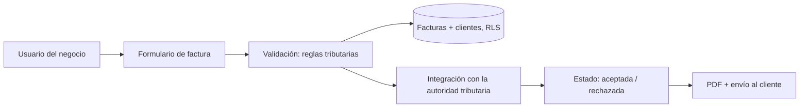

**EN** [English version](README.md)

# Comprobante Express — Caso de estudio de facturación electrónica regulada

> Estado: **en progreso** · Sanitizado: sin identificadores fiscales, facturas, credenciales ni URLs de producción.

Un producto web que permite a pequeños negocios emitir comprobantes y facturas electrónicas conformes con la autoridad tributaria peruana (SUNAT).

## Problema

Las microempresas necesitan facturar de forma rápida y conforme a la normativa, sin software de escritorio ni conocimientos contables.

## Restricciones

- Formato y reglas de validación de la autoridad tributaria.
- Protección de datos fiscales y personales.
- Experiencia de uso muy simple para usuarios no técnicos.

## Solución

## Por qué importa para Europa

La misma disciplina se aplica al **RGPD / LOPDGDD** para datos personales y a los requisitos de facturación electrónica de España, como **Veri\*factu**: registros inmutables, trazabilidad y envío validado.

## Documentos

- [LEGAL-COMPLIANCE.md](LEGAL-COMPLIANCE.md) (en inglés)

## Omitido por confidencialidad

Facturas reales, identificadores fiscales, datos de clientes, credenciales de proveedores y endpoints.
